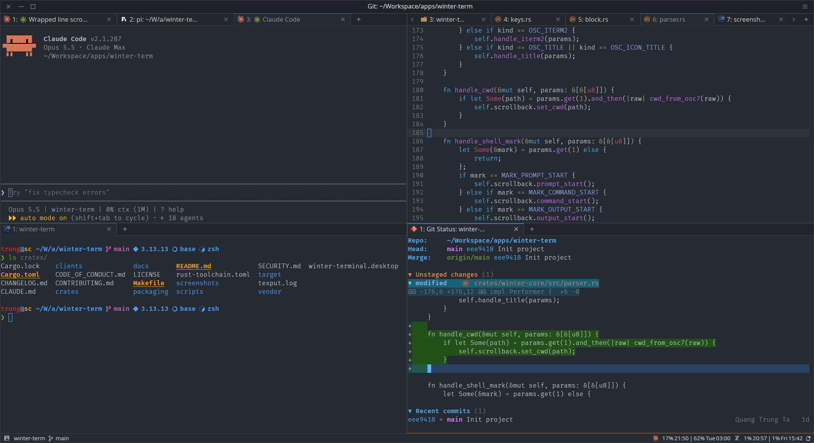

# Winter Term

Winter Term is a terminal-first IDE written in Rust. The terminal is the center: a GPU-drawn shell with full Vim editing and a built-in multiplexer. Everything else, from the text editor to git, opens as a tab beside it.



## Features

- **A modal terminal:** Vim motions, operators, text objects, and registers over the prompt line and the scrollback, in any shell, REPL, or `ssh` session, with nothing to set up on the remote host.
- **A multiplexer:** split panes, zoom them, and keep many tabs and workspaces in one window. A split opens a launcher in the same directory: `Enter` for a terminal, `f` for a file, `d` for a directory, `g` for git.
- **Editors as tabs:** a text editor with completion, on-demand LSP, and syntax highlighting; a magit-style git view; directory listings, tree search, diffs, builds, a Markdown preview with math and Mermaid, and PDF, image, and hex viewers.
- **Command blocks:** with shell integration, every command is a foldable block with its exit code and duration. Programs can print images, charts, Markdown, and tables inline through the [Terminal Block Protocol](docs/terminal-block-protocol-spec.md). All of it is drawn natively, and nothing in a block is ever run or fetched.

## Keys

A terminal tab is in Insert mode (keys go to the shell) until `Esc` switches it to Normal; `i` returns. Editor tabs have no mode and bind their own keys.

| Keys | Action |
| --- | --- |
| `M-x` | Command picker |
| `M-S-\` / `M-S--` | Split vertically, horizontally |
| `M-h/j/k/l`, `M-S-=` | Move between panes, zoom one |
| `C-S-n` / `C-S-w`, `gt` / `gT` | New or close tab, next or previous tab |
| `C-S-f` / `C-S-d` / `C-S-g` / `C-S-s` | Open a file, directory, git status, search the tree |
| `]b` / `[b` | Next or previous command block |

The [usage guide](docs/usage-guide.md) has the full keymap.

## Install

Packages for every release are on the [Releases](https://github.com/taquangtrung/winter-term/releases) page: a `.deb`, the AUR (`yay -S winter-term`), a Windows installer (also Scoop and winget), and a `.dmg` for Apple silicon. To build from source, run `cargo install winter-term` with Rust 1.96 or newer.

The macOS build is not notarized yet: open it the first time with right-click > Open, or run `xattr -dr com.apple.quarantine /Applications/Winter.app`.

## Shell integration

Command blocks and directory tracking need your shell to emit OSC 133 and OSC 7 marks. Source the script for your shell from `clients/shell-integration/` (installed to `/usr/share/winter-term/shell-integration/` on Linux):

```bash
# ~/.bashrc; use winter.zsh or winter.fish for those shells
[ -r /usr/share/winter-term/shell-integration/winter.bash ] && \
    . /usr/share/winter-term/shell-integration/winter.bash
```

## Configuration

Settings and key bindings are [KDL](https://kdl.dev/) files in `~/.config/winter-term/` (`settings.kdl`, `keybindings.kdl`), and reload as soon as they are saved.

## Documentation

- [Usage guide](docs/usage-guide.md): modes, keymaps, settings
- [Architecture](docs/architecture.md): crates and the rendering pipeline
- [Contributing](CONTRIBUTING.md), [Security policy](SECURITY.md), [Release guide](docs/releasing.md)

## License

[MIT](LICENSE)
